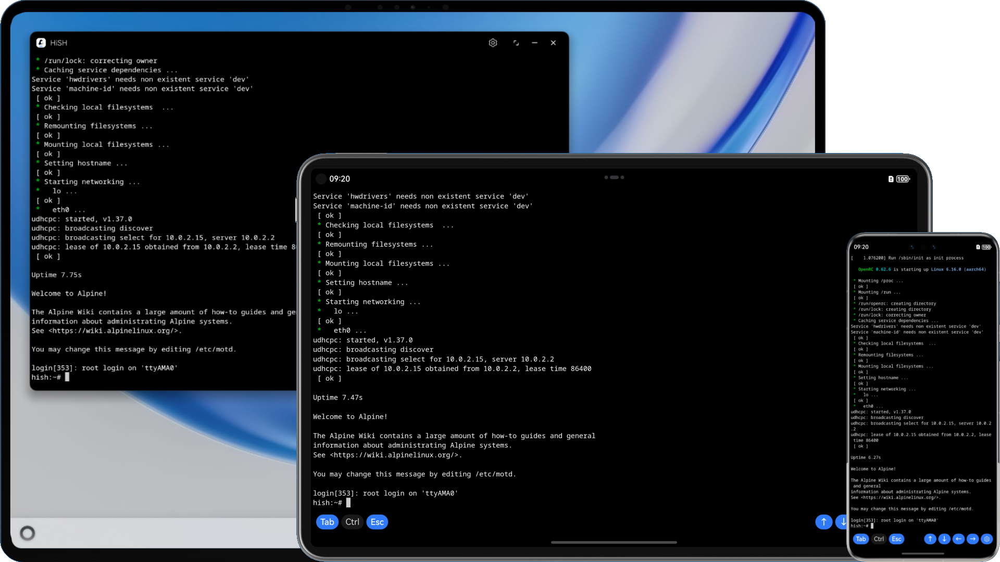
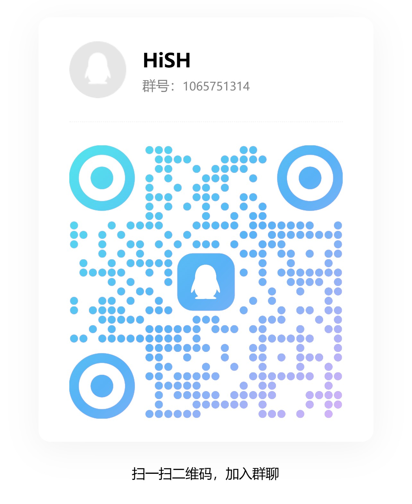

# HiSH

[GitHub](https://github.com/harmoninux/HiSH) | [GitCode](https://gitcode.com/realhackeris/HiSH) | [Gitee](https://gitee.com/hackeris/HiSH) | [English](README_EN.md)

在HarmonyOS设备上运行Linux Shell。基于[qemu-ohos](https://github.com/harmoninux/qemu)，支持2in1(PC)、平板和手机。



## 如何获取

可以选择下面任一方法获取HiSH：

- 通过[应用市场](https://appgallery.huawei.com/app/detail?id=app.hackeris.hish)安装（因应用市场政策限制，不支持JIT，运行效率一般）
- 从[Releases](https://github.com/harmoninux/HiSH/releases)下载hap文件，自行签名后安装到设备或模拟器（支持JIT，运行效率更高。安装方法见：[使用教程](https://github.com/harmoninux/HiSH/discussions/130)）
- 使用 DevEco Studio 编译源码安装，参考 [构建并安装HAP](#构建hap)（支持JIT，运行效率更高）

## 核心功能

- 完整的arm64 Linux内核
- 网络支持，并支持端口转发
- Alpine Linux根文件系统
- 虚拟按键（Tab/Ctrl/Esc/Shift/Fn/方向键）
- 共享文件夹
- JIT（Pad/2in1设备支持，Phone设备不支持）
- 镜像导入（[Ubuntu24.04镜像](https://github.com/harmoninux/linux-config/releases/download/rootfs-20251213/ubuntu-base-24.04.zip) / [Debian12镜像](https://github.com/harmoninux/linux-config/releases/download/release-20251129-debian/debian12.zip)）

## 使用指南

参考 [使用指南](docs/guide)

## 讨论交流

QQ群二维码



## 授权许可

使用本项目代码，按照[惯例](https://www.n.cn/share/r1/d256b59a563047a3a052e58042ae2547)需在软件本体"关于"中注明基于本项目（HiSH）以及本项目的仓库地址。

# 构建指南

- HAP包
- libqemu-system库（可选）
- Linux内核（可选）
- 根文件系统（可选）

## 构建HAP

* 下载安装 [DevEco Studio](https://developer.huawei.com/consumer/cn/deveco-studio/)
* 克隆代码到本地
* 仓库里执行 `git submodule update --init --recursive` 拉取子模块代码
* 复制`build-profile.template.json5`到`build-profile.json5`
* 下载以下文件到指定位置：
  - [libs.zip](https://github.com/harmoninux/qemu/releases/download/hish-20260110/libs.zip)（解压到`feature/hish_main/libs`）
  - [feature/hish_main/src/main/resources/rawfile/vm/kernel_aarch64](https://github.com/harmoninux/linux-config/releases/download/kernel-20260228/kernel_aarch64)
  - [feature/hish_main/src/main/resources/rawfile/vm/rootfs_aarch64.qcow2](https://github.com/harmoninux/linux-config/releases/download/rootfs-20260117/rootfs_aarch64.qcow2)
* 在DevEco Studio中构建项目（默认构建`product/tablet`，如需同时构建Phone版，取消`build-profile.json5`中phone模块的注释）
* 签名后在设备或模拟器上运行。参考 [本地真机运行应用](https://developer.huawei.com/consumer/cn/doc/harmonyos-guides/ide-run-device) | [自动签名-未关联注册应用](https://developer.huawei.com/consumer/cn/doc/harmonyos-guides/ide-signing#section151231211105010)

## 构建libqemu-system（可选）

在Ubuntu或Windows的WSL2环境下构建自定义的`libqemu-system-aarch64.so`：

* 安装依赖：

```shell 
sudo apt install -y build-essential cmake curl wget unzip python3 libncurses-dev \
    git flex bison bash make autoconf libcurl4-openssl-dev tcl \
    gettext zip pigz meson 
```

* 从[华为开发者官网](https://developer.huawei.com/consumer/cn/download/)下载Linux版"Command Line Tools"
* 解压后将`TOOL_HOME`环境变量设置为解压目录
* 进入`deps`目录运行`make`（默认针对x86_64模拟器）：
    * 针对真机的构建（arm64-v8a），需要执行`make aarch64`
    * 针对不支持JIT的Phone设备，可执行`make aarch64-tci`，使用QEMU TCG解释器（TCI）构建，并生成`libqemu-system-aarch64-tci.so`。TCI性能低于JIT，但不依赖JIT支持。
```shell 
cd deps 
make
```
* 构建产物位于`deps/output`目录

## 构建Linux内核（可选）

* 安装依赖：

```shell 
sudo apt install build-essential gcc bc bison flex libssl-dev \
 libncurses5-dev libelf-dev gcc-aarch64-linux-gnu \
 clang lld llvm make 
```

* 克隆Linux内核源码：

```shell 
git clone --depth=1 -b v6.12 https://github.com/torvalds/linux 
```

* 下载内核配置：

```shell 
cd linux 
curl https://raw.githubusercontent.com/harmoninux/linux-config/refs/heads/master/arm64_virt > .config 
```

* 编译内核：

```shell
export KCFLAGS='-march=armv8.5-a+crc+crypto+lse+rcpc+rng+sm4+sha3+dotprod+fp16 -mtune=neoverse-n1 -O2 -falign-functions=64 -fno-strict-aliasing -mllvm -vectorize-loops -mllvm -force-vector-width=2'
env KCFLAGS="$KCFLAGS" make ARCH=arm64 CROSS_COMPILE=aarch64-linux-gnu- LLVM=1 LLVM_IAS=1 menuconfig
env KCFLAGS="$KCFLAGS" make ARCH=arm64 CROSS_COMPILE=aarch64-linux-gnu- LLVM=1 LLVM_IAS=1 -j$(nproc)
```

* 内核镜像位于`arch/arm64/boot/Image`，复制到项目对应目录

## 构建Linux根文件系统（可选）

以下是构建自定义根文件系统的完整流程

* 准备Alpine根文件系统

```shell 
# 创建目录并解压Alpine最小根文件系统 
mkdir alpine 
wget https://dl-cdn.alpinelinux.org/alpine/v3.22/releases/aarch64/alpine-minirootfs-3.22.1-aarch64.tar.gz 
tar xvf alpine-minirootfs-3.22.1-aarch64.tar.gz -C alpine 
```

* 创建磁盘镜像文件

```shell 
# 创建8GB大小的原始镜像文件（可根据需要调整大小）
qemu-img create -f raw rootfs.img 8G 
 
# 格式化为ext4文件系统 
mkfs.ext4 rootfs.img 
```

* 挂载并填充文件系统

```shell 
# 创建挂载点并挂载镜像 
sudo mkdir -p /mnt/rootfs 
sudo mount -o loop rootfs.img /mnt/rootfs 
 
# 复制Alpine文件系统内容 
sudo cp -a alpine/* /mnt/rootfs/
 
# 卸载镜像 
sudo umount /mnt/rootfs 
```

* 转换为qcow2格式

```shell 
# 转换格式（qcow2支持动态分配空间）
qemu-img convert -p -f raw -O qcow2 rootfs.img rootfs.qcow2 
```

* 部署到项目

```shell 
# 将生成的文件放入项目目录 
mkdir -p feature/hish_main/src/main/resources/rawfile/vm/
mv rootfs.qcow2 feature/hish_main/src/main/resources/rawfile/vm/rootfs_aarch64.qcow2 
```

# Star history

[](https://star-history.dera.page/#harmoninux/hish&Date)


（本章节所有数字均有可复现台账：SCORE.json / raw/idle_ab_*.json / device_thread_attribution.txt / SHA256SUMS 163 项对账全绿，可按需提供样本。）

> 附：同批测量含 iothread `poll-max-ns=2000000` 忙轮询与 VNC 静止刷新的宿主侧归因数据（本仓库 issue #182），供 qemu-ohos 上游默认值评估。原始终端级 CSV/JSON 台账可应要求提供。


## 手机端长驻与省电调优（实测数据版）

适用场景：把 HiSH 当"掌上 Linux 服务器"长期挂着跑常驻服务（消息网关 / SSH / agent 等）。

### 一句话结论
锁屏后台的耗电大头 = **guest 内无关常驻服务（可省 ~57%）** > **HiSH 管线轮询税（iothread/VNC/QGA，约 0.5~0.7 核，普通用户不可调）** > 内核 config 调优（实测无收益，不必折腾）。

### 实操清单（按收益排序）
1. **裁剪 guest 常驻服务**：`systemctl disable --now <非必要服务>`。非破坏做法是删 systemd wants 软链，unit 本体保留，随时 `enable --now` 回滚。
   - 实测（Mate80，dev 签名版，n=15×四臂 bracketed，双基线吻合 1.1%）：禁用三个无关服务后，锁屏后台宿主空转 CPU **1.615 → 0.698 核（−56.8%）**
2. **不用时"暂停"而非"划掉"**：暂停保留内存状态、恢复秒级、连接不断；划掉 = 冷启动（实测 force-stop 重开 → qga up 中位 10.4s、端到端应答 13.4s，服务需重连）。
3. **自启与自愈军规**：需要长驻的服务 unit 配 `Restart=always` + `RestartSec=3`，`systemctl enable --now`，配合系统保活卡片即可 60 分钟+ 锁屏存活（实测 5/5 节点、boot_id 不变）。
4. **发行版选择**：Ubuntu 24 LTS 够用且与官方导入镜像生态一致；换更新发行版对常驻功耗影响≈0（数据都在盘里，迁移成本远大于收益）。Alpine 轻量但无 systemd，长驻服务治理会失去现成工具。
5. **内核**：官方 stock 内核即可——stock / 调优 / 裁剪三版对照实测，boot 与吞吐差异全部落在噪声带内；裁剪版还可能因块设备配置（如去掉 SCSI）导致镜像挂不上 root。
6. **进阶（非官方支持区）**：对功耗极致敏感的场景，考虑在宿主原生容器/proot 环境跑服务（无指令翻译税），HiSH 保留给需要完整 VM 隔离的工作负载。

### 待上游澄清的口径
- README 标注 "JIT: Pad/2in1 支持，Phone 不支持"，但发布口径提到开发版可用 JIT。Phone 真机 dev 签名版实际走 TCG JIT 还是 TCI 构建，建议文档给出**可自查的判定方法**（如 guest 内简易 CPU 基准或启动日志特征）。

---

（本章节所有数字均有可复现台账：SCORE.json / raw/idle_ab_*.json / device_thread_attribution.txt / SHA256SUMS 163 项对账全绿，可按需提供样本。）

> 附：同批测量含 iothread `poll-max-ns=2000000` 忙轮询与 VNC 静止刷新的宿主侧归因数据（harmoninux/HiSH issue #182），供 qemu-ohos 上游默认值评估。原始 CSV/JSON 台账可应要求提供。
